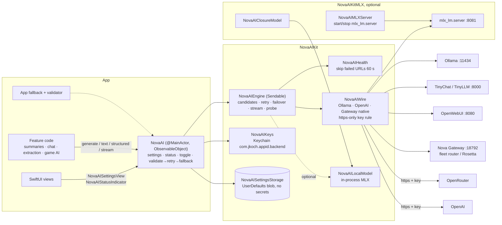
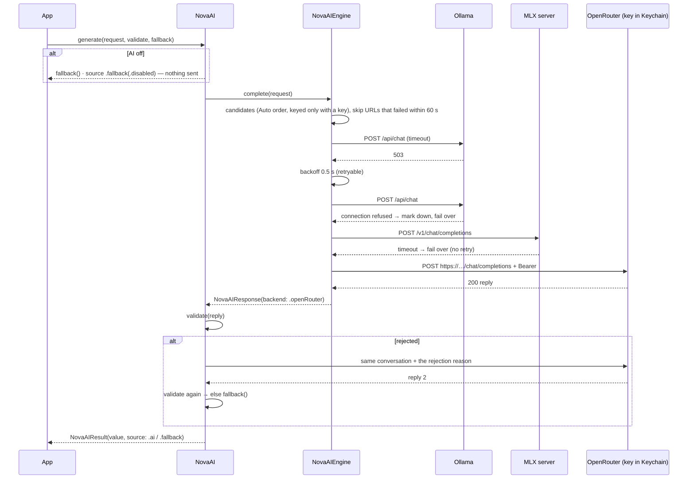

# NovaAIKit

One AI feature set for every app. NovaAIKit is a Swift package that gives a macOS, iOS or tvOS app the same AI
options and behaviour as every other app in the family: an on/off switch, a scripted fallback, nine backends with
Auto failover, keys kept in the Keychain, a status indicator, output validation, structured output, streaming, and a
drop-in settings screen. Each app adds the package in place of its own copy of the AI code.

- **Version:** 1.0.0
- **Platforms:** macOS 12+, iOS 15+, tvOS 15+. These are the lowest deployment targets Xcode 27 can still build, and
  they cover every adopting app. GTNW iOS is 15. Stream Rotator and RTSP Rotator declare macOS 11, which Xcode 27
  rejects, so they move to 12.0 when they adopt.
- **Swift:** tools 6.0, Swift 6 language mode, Sendable-correct, zero warnings. Apps in Swift 5 mode can use it.
- **Dependencies:** none.
- **How to migrate an app:** see [ADOPTION.md](ADOPTION.md).

## Features

| # | Feature | How |
|---|---|---|
| 1 | AI on/off, saved per app | `ai.isEnabled` / `settings.enabled`. When it's off, nothing is sent and every caller gets its fallback. |
| 2 | Scripted fallback | `generate(_:validate:fallback:)`, `text(_:fallback:)` and `structured(_:_:fallback:)` never throw. The fallback closure is the app's own. A failed call can't block the app. |
| 3 | Backends, model picker, editable URLs | `auto, ollama, mlx, tinyllm, tinychat, openwebui, novagateway, openrouter, openai`. `listModels(for:)` asks the backend for its models. Every URL can be edited and defaults to localhost. |
| 4 | Keys only in the Keychain | Service `com.jkoch.<appid>.<backend>`, account `apiKey`. Keys are never stored in UserDefaults, the environment or files. One-time migration helpers move keys from old Keychain items and from plaintext UserDefaults. |
| 5 | https only for keys | A request that carries a key is refused before it's sent unless it uses https. OpenRouter and OpenAI always need https. OpenWebUI's optional key may also go over plain http to this machine (loopback). |
| 6 | Observable status | `ai.status` holds the active backend, host, model, reachability per backend, last error, latency and where the last answer came from. `NovaAIStatusIndicator` shows it in SwiftUI. |
| 7 | Auto failover | Fixed order: Ollama → MLX → TinyChat → TinyLLM → OpenWebUI → Nova Gateway → OpenRouter → OpenAI. Each request has a timeout. A backend gets bounded retries with backoff (408/429/5xx). A server that just failed is skipped for 60 s. |
| 8 | Output validation | The app's validator rejects a reply by throwing, or clamps it by returning a corrected value. After a rejection the kit asks once more and passes on the reason, then uses the fallback. |
| + | Streaming | `stream(_:)` yields text deltas: Ollama NDJSON or OpenAI SSE. `<think>` blocks are removed, even when a tag is split across chunks. |
| + | Structured output | `structured(T.self, request, schema:)` sends a native JSON schema where the backend supports one (Ollama `format`, OpenAI/OpenRouter `response_format`). Otherwise the schema goes in the prompt. The reply is then decoded and validated. |
| + | Drop-in settings | `NovaAISettingsView(ai:)` has the toggle, backend and timeout pickers, URL and model per backend, a model list, SecureField key entry (saved to the Keychain, never shown) and Test connection. |
| + | Nova fleet | The `novagateway` backend speaks OpenAI `/v1/chat/completions`, which covers the fleet inference router, Rosetta and any OpenAI-compatible server. If a URL answers 404, the kit switches to the Nova Gateway V2 API (`/api/chat` with `person: "service"`) and remembers that for the URL. |
| + | Legacy drop-ins | `generate(prompt:systemPrompt:temperature:maxTokens:)` has the same signature as the old `AIBackendManager.shared.generate`. `migrateFromLegacyAIBackendManager()` imports the old settings and keys and deletes obsolete secrets. |

Google, Azure, AWS and IBM Watson are left out on purpose. They were stubs that never worked. To reach Claude, use
OpenRouter (e.g. `anthropic/claude-sonnet-4.5`) or the Nova Gateway.

## Architecture



### Failover sequence (Auto)



## Install (Swift Package Manager)

**Package.swift**

```swift
.package(url: "https://github.com/kochj23/NovaAIKit.git", from: "1.0.0"),
// target:
.product(name: "NovaAIKit", package: "NovaAIKit"),
// optional, macOS: .product(name: "NovaAIKitMLX", package: "NovaAIKit"),
```

**XcodeGen (`project.yml`)**

```yaml
packages:
  NovaAIKit:
    url: https://github.com/kochj23/NovaAIKit.git
    from: 1.0.0
targets:
  MyApp:
    dependencies:
      - package: NovaAIKit
        product: NovaAIKit
```

**Plain `.xcodeproj`:** run `ruby scripts/add-novaaikit.rb MyApp.xcodeproj MyApp`, or in Xcode use File > Add Package
Dependencies… and enter the URL. The package URL is the public https one, so it needs no credentials.

## Quick start

```swift
import NovaAIKit

@MainActor enum AppAI {
    static let shared: NovaAI = {
        let ai = NovaAI(configuration: NovaAIConfiguration(appID: "newssummary", appName: "News Summary"))
        ai.migrateFromLegacyAIBackendManager()                       // old UserDefaults settings + plaintext key
        ai.migrateLegacyKey(service: "com.jordankoch.NewsSummary.AIBackend", account: "openAIAPIKey", to: .openAI)
        return ai
    }()
}

// Throwing, drop-in for the old manager:
let summary = try await AppAI.shared.generate(prompt: text, systemPrompt: "Summarize.", temperature: 0.3, maxTokens: 300)

// Never throws: AI → validated → else the app's own answer.
let r = await AppAI.shared.text(NovaAIRequest(prompt: prompt, system: sys)) { builtInSummary }
label.text = r.value          // r.source.label → "AI · Ollama (qwen3:8b)" or "Built-in"

// Structured extraction with a schema and a clamp:
struct Triage: Codable, Sendable { var category: String; var priority: Int }
let schema = try NovaAIJSONSchema(name: "triage", json: #"{"type":"object","required":["category","priority"],"properties":{"category":{"type":"string"},"priority":{"type":"integer"}}}"#)
let t = await AppAI.shared.structured(Triage.self, NovaAIRequest(prompt: email), schema: schema,
                                      validate: { var t = $0; t.priority = min(max(t.priority, 1), 5); return t },
                                      fallback: { Triage(category: "other", priority: 3) })

// Streaming chat:
for try await delta in AppAI.shared.stream(NovaAIRequest(messages: history)) { output += delta }

// SwiftUI:
NovaAISettingsView(ai: AppAI.shared, footer: "When AI is off, summaries use the first paragraph.")
NovaAIStatusIndicator(ai: AppAI.shared)
```

## API summary

| Type | Role | Key members |
|---|---|---|
| `NovaAI` | `@MainActor ObservableObject`, the app's one object | `init(configuration:storage:keyStore:session:sleep:localModel:)`, `settings`, `status`, `isEnabled`, `complete(_:)`, `generate(prompt:systemPrompt:temperature:maxTokens:)`, `chat(_:)`, `stream(_:)`, `streamEvents(_:)`, `generate(_:validate:fallback:)`, `text(_:validate:fallback:)`, `structured(_:_:schema:validate:fallback:)`, `refreshStatus()`, `testConnection(_:)`, `listModels(for:)`, `setAPIKey(_:for:)`, `hasAPIKey(for:)`, `migrateLegacyKey(service:account:to:deleteLegacy:legacyStore:)`, `migrateLegacyDefaultsKey(_:defaults:to:)`, `migrateLegacySettings(from:)`, `migrateFromLegacyAIBackendManager(defaults:)` |
| `NovaAIConfiguration` | Fixed per-app facts | `appID`, `appName`, `appURL`, `keychainAccessGroup`, `defaultSettings`, `retry`, `probeTimeout`, `healthTTL`, `maxInputCharacters`, `maxOutputCharacters`, `keychainService(for:)` |
| `NovaAISettings` | User settings (no secrets), Codable, decodes tolerantly | `enabled`, `backend`, `url(for:)`/`setURL`, `model(for:)`/`setModel`, `extraOllamaEndpoints`, `timeout` |
| `NovaAIBackend` | Canonical ids | `autoOrder`, `selectable`, `displayName`, `defaultURL`, `defaultModel`, `requiresKey`, `acceptsKey`, `supportsJSONSchema`, `init?(legacyName:)` |
| `NovaAIRequest` / `NovaAIMessage` | Input | `init(prompt:system:temperature:maxTokens:format:)`, `init(messages:…backend:model:timeout:reasoning:)` |
| `NovaAIResponseFormat` / `NovaAIJSONSchema` | Structured output | `.text`, `.json`, `.jsonSchema(schema)`. Schemas come from a JSON string or a dictionary. |
| `NovaAIResponse` | Successful answer | `text`, `backend`, `model`, `endpoint`, `latency`, `attempts` |
| `NovaAIResult<T>` / `NovaAISource` | Answer from the never-throwing API | `value`, `source` (`.ai(backend:model:)` / `.fallback(reason)`), `response`, `source.label` |
| `NovaAIError` / `NovaAIValidationError` | Errors (key-free) | `.disabled`, `.missingKey`, `.insecureTransport`, `.httpStatus`, `.timedOut`, `.allBackendsFailed`… |
| `NovaAIStatus` | Observable status | `state` (`off/unknown/checking/online/offline`), `activeBackend`, `host`, `reachability`, `lastError`, `lastLatency`, `lastSource`, `label` |
| `NovaAIEngine` | Sendable network engine (usable off the main actor, e.g. CLIs) | `candidates`, `complete`, `stream`, `probe`, `probeAll`, `listModels` |
| `NovaAIKeys`, `NovaAIKeychain`, `NovaAIMemoryKeyStore` | Secrets | `key(for:)`, `setKey`, `migrateLegacyKey`, `migrateLegacyDefaultsKey`, `deleteObsoleteLegacyItems(service:)` |
| `NovaAIUserDefaultsStorage`, `NovaAIMemoryStorage`, `NovaAISettingsStorage` | Settings persistence | Implement the protocol to keep settings elsewhere (e.g. a database). |
| `NovaAILegacySettings` | Old `AIBackendManager` UserDefaults keys | `read(from:base:)`, `removeObsoleteKeys(from:)` |
| `NovaAIRetryPolicy`, `NovaAIRetry`, `NovaAIHealth` | Resilience | default 2 attempts/backend, 0.5 s base, ×2, max 4 s; health TTL 60 s |
| `NovaAIText` | Pure helpers | `clean`, `jsonPayload`, `decode`, `numbers`, `grounded`, `plain`, `listItems` |
| `NovaAILocalModel` | Plug an in-process engine into `mlx` | `isAvailable()`, `complete(messages:temperature:maxTokens:)` |
| `NovaAISettingsView`, `NovaAIStatusIndicator` | SwiftUI | drop-in views |
| `NovaAIMLXServer`, `NovaAIClosureModel` (NovaAIKitMLX) | Optional MLX | start/stop `mlx_lm.server` on loopback; wrap any closure as a local model |

## Backends

| id | Default URL | Chat path | Models path | Key |
|---|---|---|---|---|
| `ollama` | http://localhost:11434 | /api/chat | /api/tags | none |
| `mlx` | http://localhost:8081 | /v1/chat/completions | /v1/models | none (or in-process) |
| `tinychat` | http://localhost:8000 | /api/chat/stream | / | none |
| `tinyllm` | http://localhost:8000 | /v1/chat/completions | /v1/models | none |
| `openwebui` | http://localhost:8080 | /api/chat/completions | /api/models | optional |
| `novagateway` | http://127.0.0.1:18792 | /v1/chat/completions → /api/chat | /v1/models | none |
| `openrouter` | https://openrouter.ai/api/v1 | /chat/completions | /models | required, https |
| `openai` | https://api.openai.com/v1 | /chat/completions | /models | required, https |

Extra Ollama-compatible servers can be listed in `settings.extraOllamaEndpoints` (LAN hosts, the fleet router) and
are tried after the primary Ollama URL. On Ollama, `think` is false unless the request sets `reasoning: true`. That
stops a reasoning model from spending the whole token budget thinking and returning an empty answer. Any `<think>`
block that still comes back is removed.

### MLX choice

The core `mlx` backend talks over HTTP to `mlx_lm.server` (OpenAI-compatible). mlx-swift is **not** a dependency, for
two reasons: it needs a Metal shader build that plain `swift build`/`swift test` can't do, and it would raise the
minimum to macOS 14, which the macOS 12/13 apps can't adopt. The optional **NovaAIKitMLX** product adds two things:

- `NovaAIMLXServer` starts `python3 -m mlx_lm.server` bound to 127.0.0.1 and stops it again.
- `NovaAIClosureModel` wraps any in-process engine as a `NovaAILocalModel`. An app that already links mlx-swift (such
  as MLX Code) plugs its engine into the `mlx` backend this way.

## Keychain naming

| Item | Value |
|---|---|
| Service | `com.jkoch.<appID>.<backend>`, e.g. `com.jkoch.mailsummary.openrouter` |
| Account | `apiKey` |
| Accessibility | `kSecAttrAccessibleAfterFirstUnlockThisDeviceOnly` |
| Access group | `NovaAIConfiguration.keychainAccessGroup`: nil means the login/app keychain; set it for the Data Protection keychain |

Updates are made in place, so the item's ACL survives. Saving an empty value deletes the item. Keys are trimmed and
never logged, and never appear in settings, status or errors (there are tests for this).

## Tests

```
swift test
```

| Category | File | Tests |
|---|---|---|
| Unit | `UnitTests.swift` | 31 |
| Security | `SecurityTests.swift` | 18 |
| Retry | `RetryTests.swift` | 13 |
| Functional | `FunctionalTests.swift` | 29 |
| Performance | `PerformanceTests.swift` | 9 |
| Frame / UI state | `FrameTests.swift` | 9 |
| Integration (live local Ollama; skips when unreachable) | `IntegrationTests.swift` | 4 |
| **Total** | | **113** |

The network is stubbed with a `URLProtocol` (`Support.swift`), and the tests use in-memory key and settings stores.
No real key is ever used. The one real-Keychain test uses a throwaway service, deletes it afterwards, and skips if no
keychain is available. The integration tests use the local Ollama when it's reachable; `NOVAAIKIT_TEST_MODEL` picks
the model. The package also builds with zero warnings for macOS, iOS and tvOS (`xcodebuild -scheme NovaAIKit-Package
-destination 'generic/platform=iOS' build`).

## Changelog

See [CHANGELOG.md](CHANGELOG.md).

## License

MIT. Copyright © 2026 Jordan Koch.
